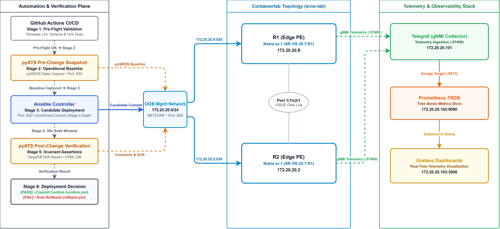

# SROS Automation Starter

[](https://github.com/dennis-3/sros-automation-starter/actions/workflows/ci.yml)
[](LICENSE.md)
[](https://www.nokia.com)
[](https://containerlab.dev)

Starter repository for automating Nokia SR OS using Ansible, NETCONF, and pyATS. Contains Jinja2 NETCONF templates, playbooks, Containerlab topology integration, and automated state-drift testing.

## System Architecture



## Directory Structure

```text
sros-automation-starter/
├── .github/
│   └── workflows/
│       ├── ci.yml                # CI test, schema validation, and security scan workflow
│       └── deploy.yml            # Automated lab deployment & verification workflow
├── ansible.cfg                   # Ansible settings (forks, timeouts, default inventory)
├── ansible/
│   ├── group_vars/
│   │   ├── all.yml               # Global credentials, connection parameters, commit toggles
│   │   ├── edge_pe.yml           # Edge PE role settings
│   │   └── core_p.yml            # Core P role settings
│   ├── host_vars/
│   │   ├── r1.yml                # Baseline host variables for R1
│   │   └── r2.yml                # Baseline host variables for R2
│   ├── inventory.yml             # Role-based inventory (edge_pe, core_p, access_ce)
│   ├── netbox_inventory.yml      # Dynamic NetBox inventory plugin config
│   ├── playbooks/
│   │   ├── deploy.yml            # Main deployment orchestrator (atomic candidate staging)
│   │   ├── tasks/                # Modular deployment pipeline tasks (01_preflight to 09_commit)
│   │   ├── snapshot.yml          # Operational state & config snapshot retrieval
│   │   └── netconf_ops.yml       # Raw NETCONF operations (BOF, load XML, md-compare)
│   ├── templates/                # 23 Jinja2 NETCONF XML templates
│   ├── execution-environment.yml # Ansible Execution Environment (EE) definition
│   └── ansible-navigator.yml     # Containerized execution settings
├── examples/
│   └── data_models/              # Reference data schemas (BGP, VPNs, MPLS, QoS, etc.)
├── license/
│   ├── README.md                 # License instructions & Containerlab integration
│   └── license.txt.example       # Example template for Nokia TiMOS license
├── tests/
│   └── validate_templates.py     # Pre-flight template rendering & XML schema validator
├── topology.yaml                 # Containerlab topology (r1, r2, AAA, telemetry)
├── tac_plus.conf                 # TACACS+ server configuration (AAA container)
├── telegraf.conf                 # Telegraf gNMI telemetry collector configuration
├── prometheus.yml                # Prometheus metrics scraper configuration
├── grafana_datasource.yaml       # Grafana automated datasource provisioning
├── pyats_testbed.yml             # pyATS testbed definition
├── pyats_test_suite.py           # Multi-threaded snapshot & diff test suite
├── .env.example                  # Centralized environment variable template
├── .editorconfig                 # Cross-editor formatting specifications
├── .pre-commit-config.yaml       # Git hooks (YAML, formatting, Ruff)
├── .gitleaks.toml                # Security scanning configuration
├── CHANGELOG.md                  # Release version history
├── CONTRIBUTING.md               # Community contribution guidelines
├── CODE_OF_CONDUCT.md            # Contributor Covenant v2.1 code of conduct
├── LICENSE.md                    # MIT Open Source License
├── Makefile                      # Standardized workflow task runner
├── requirements.txt              # Python dependencies
└── README.md
```

## Quick Start (Make)

```bash
# Setup & Lab Lifecycle
make install         # Install Python dependencies, Ansible collections & pre-commit hooks
make lab-up          # Spin up Containerlab topology (r1, r2, AAA, telemetry)
make lab-down        # Destroy Containerlab topology

# Deployment & Staging
make check           # Dry-run Ansible deployment with candidate diff preview
make deploy          # Deploy configuration to all routers
make canary-deploy   # Deploy configuration in rolling canary batches (1 router/batch)
make snapshot        # Retrieve operational state snapshot in JSON via Ansible

# Testing & Verification
make test-pre        # Capture pre-change baseline network state via pyATS
make test-post       # Verify post-change state and generate HTML drift report
make validate        # Fast pre-flight check: Jinja2 templates, XML render, and schemas
make lint            # Full static analysis: validate, pre-commit hooks, and ansible-lint

# Containerized Execution & Maintenance
make build-ee        # Build containerized Execution Environment (sros-ee:latest)
make clean           # Clean up test snapshots, cache directories, and temporary files
```

## Setup

```bash
python -m venv .venv
source .venv/bin/activate  # Linux/macOS
# .venv\Scripts\Activate.ps1  # Windows PowerShell

make install  # Installs Python dependencies, Ansible collections, and pre-commit hooks

# Or install manually without Make:
# pip install -r requirements.txt
# ansible-galaxy collection install -r ansible/requirements.yml
# pre-commit install
```

### Nokia SR OS License Setup

Before launching the Containerlab topology, provide your Nokia SR OS (TiMOS) simulation license file:

```bash
# Copy your license into the license/ directory
cp /path/to/your/timos_license.txt license/license.txt
```

> **Note**: `license/license.txt` is untracked by Git to protect proprietary license keys. See [`license/README.md`](license/README.md) for format details and `license/license.txt.example` for reference.

### Environment Variables & Credentials

Credentials can be injected dynamically via environment variables for Ansible and pyATS (falling back to lab defaults if unset):

```bash
export SROS_USER="admin"
export SROS_PASSWORD="your_secure_password"
export SROS_PORT="830"
```

If using NetBox dynamic inventory:

```bash
export NETBOX_URL="http://172.17.0.1:8000"  # NetBox API endpoint
export NETBOX_TOKEN="your_token"           # NetBox REST API token
```

## Running Ansible

The repository includes a root `ansible.cfg` configured with `forks = 20`, persistent connection timeouts (`connect_timeout = 60s`, `command_timeout = 180s`), and default inventory pointing to `ansible/inventory.yml`.

### Full Deployment

```bash
ansible-playbook ansible/playbooks/deploy.yml
```

### Dry Run with Candidate Delta Preview (Check Mode)

Run check mode to stage configuration, preview the rendered candidate changes via Nokia MD-CLI `md-compare`, and automatically discard changes to leave the candidate datastore pristine:

```bash
ansible-playbook ansible/playbooks/deploy.yml --check -e sros_show_diff=true
```

### Confirmed Commit with Auto-Rollback

Deploy core changes with a confirmed commit window (in seconds). If connectivity fails or confirming commit is not received, SR OS automatically rolls back:

```bash
ansible-playbook ansible/playbooks/deploy.yml -e sros_confirm_timeout=120
```

### Canary Rollouts (Rolling Batches)

Deploy changes in rolling batches with failure thresholds:

```bash
# Canary deployment: 1 router at a time
ansible-playbook ansible/playbooks/deploy.yml -e sros_serial_batch=1

# Percentage-based canary batching with zero fail tolerance
ansible-playbook ansible/playbooks/deploy.yml -e sros_serial_batch=20% -e sros_max_fail_percentage=0
```

### Target Specific Device Roles

The inventory defines role groups (`edge_pe`, `core_p`, `access_ce`). Use `--limit` to target specific tiers:

```bash
ansible-playbook ansible/playbooks/deploy.yml --limit edge_pe
ansible-playbook ansible/playbooks/deploy.yml --limit core_p
```

### Running with Containerized Execution Environment (EE)

To build the execution environment image locally using `ansible-builder`:

```bash
ansible-builder build -f ansible/execution-environment.yml -t sros-ee:latest
```

Run playbooks via `ansible-navigator` (auto-detects Podman or Docker):

```bash
ansible-navigator run ansible/playbooks/deploy.yml --mode stdout
```

### Running Specific Tasks by Tag

You do not need to supply all tags. Provide any single tag to run matching tasks:

```bash
# Run only interface tasks:
ansible-playbook ansible/playbooks/deploy.yml --tags interfaces

# Run all routing tasks (ISIS, OSPF, BGP, policy):
ansible-playbook ansible/playbooks/deploy.yml --tags routing

# Run a specific protocol:
ansible-playbook ansible/playbooks/deploy.yml --tags isis
ansible-playbook ansible/playbooks/deploy.yml --tags bgp

# Run services:
ansible-playbook ansible/playbooks/deploy.yml --tags services
ansible-playbook ansible/playbooks/deploy.yml --tags vprn
```

Available tags:
`system`, `hardware`, `filters`, `acl`, `interfaces`, `base-routing`, `underlay`, `routing`, `isis`, `ospf`, `mpls`, `ldp`, `rsvp`, `bier`, `mpls-labels`, `policy-options`, `bgp`, `overlay`, `services`, `epipe`, `vpls`, `vprn`, `ies`, `sdp`, `pw-templates`, `qos`, `igmp`, `pim`, `multicast`, `mirror`, `telemetry`. Both kebab-case and snake_case alias variants are supported.

### Candidate Datastore & Atomic Commits

By default, `deploy.yml` operates in atomic mode:

- All configuration tasks stage changes to the Nokia SR OS candidate datastore without committing (`commit: false`).
- In check mode (`--check`) or with `-e sros_show_diff=true`, the playbook queries Nokia's native `md-compare` RPC to preview the exact CLI changes before committing.
- A final commit task tagged `always` locks the candidate store, verifies, and executes a single atomic commit.
- If any staging task or validation fails, an automated `rescue` block triggers `<discard-changes/>` via NETCONF RPC, rolling back the candidate buffer to prevent dirty state accumulation.
- If task-by-task committing is required for troubleshooting, pass `-e sros_commit_per_task=true`:

```bash
ansible-playbook ansible/playbooks/deploy.yml --tags interfaces -e sros_commit_per_task=true
```

### Operational State & Configuration Snapshots

Capture running configuration or operational state snapshots in JSON, YAML, or XML:

```bash
# Snapshot operational state in JSON
ansible-playbook ansible/playbooks/snapshot.yml --tags state-json

# Snapshot running configuration in YAML
ansible-playbook ansible/playbooks/snapshot.yml --tags config-yaml

# Targeted subtree query (e.g. interfaces only):
ansible-playbook ansible/playbooks/snapshot.yml --tags state-json \
  -e 'sros_state_filter="<state xmlns=\"urn:nokia.com:sros:ns:yang:sr:state\"><router><router-name>Base</router-name><interface/></router></state>"'
```

### Reference Data Model Catalog

Reference data schemas for supported Nokia SR OS features are located in `examples/data_models/`:

- `01_underlay_routing.yml`: IS-IS, OSPF, Segment Routing (SRGB), BIER
- `02_mpls_signaling.yml`: MPLS, RSVP-TE CSPF LSPs, LDP, SDP transport tunnels, Pseudowire templates
- `03_bgp_and_policies.yml`: Prefix lists, route policy statements, iBGP/eBGP peering, MP-BGP
- `04_l2_vpn_services.yml`: Point-to-point Epipes (VPWS) and multipoint VPLS (with BGP-AD & EVPN)
- `05_l3_vpn_services.yml`: VPRN (L3VPN) with MP-BGP auto-bind tunnels, VRF interfaces, IES services
- `06_security_and_qos.yml`: IP traffic filters (ACLs), SAP-ingress / SAP-egress QoS queuing, NTP, TACACS+ AAA
- `07_multicast_and_mirror.yml`: IGMP, PIM (Sparse Mode, SSM, Anycast RP), Port Mirroring

### Pre-Flight Validation & Code Quality

Run fast pre-flight validation (Jinja2 AST, XML schema rendering, Python syntax, and YAML schemas):

```bash
make validate
```

Or run the full static analysis suite (includes `validate`, all pre-commit formatting/Ruff checks, and `ansible-lint`):

```bash
make lint
```

## Hardware & Port Provisioning

Hardware and physical port definitions in `host_vars/<hostname>.yml` follow native Nokia SR OS YANG data hierarchies, configuring cards, MDAs, connector breakouts, and Ethernet encapsulation:

```yaml
# Hardware & Card Provisioning (Nokia SR-1 / SR-1s / 7750 SR / vSIM)
cards:
  - slot: 1
    type: "iom-1"
    mdas:
      - slot: 1
        type: "me6-100gb-qsfp28"

# Port & Connector Provisioning (Native SR OS YANG port hierarchy)
ports:
  - id: "1/1/c1"
    connector:
      breakout: "c1-100g"
  - id: "1/1/c1/1"
    ethernet:
      mode: "hybrid"
      encap_type: "dot1q"
```

### Resource Decommissioning (Preventing Config Drift)

To remove interfaces, filters, or services without leaving orphaned configurations on the router, set `state: absent`:

```yaml
interfaces:
  - name: "toR2"
    state: absent

epipe_services:
  - id: "epipe-100"
    state: absent
```

Templates render NETCONF `operation="remove"` to delete the target element from the Nokia SR OS datastore during the atomic transaction.

## Testing & Verification (pyATS)

Capture pre-change and post-change router state, then generate an HTML diff:

```bash
# 1. Capture baseline state:
python pyats_test_suite.py --testbed pyats_testbed.yml --mode pre

# 2. Deploy changes via Ansible:
ansible-playbook ansible/playbooks/deploy.yml --tags interfaces

# 3. Capture post-change state and compare:
python pyats_test_suite.py --testbed pyats_testbed.yml --mode post
```

Optional flags:

- `--limit`: Comma-separated router names or patterns to restrict verification scope during targeted changes (e.g., `--limit r1` or `--limit edge_pe`).
- `--inventory`: Path to Ansible inventory YAML file (`ansible/inventory.yml`) to dynamically synthesize pyATS testbed definitions on-the-fly, eliminating duplicate testbed drift.
- `--testbed`: Testbed YAML path (auto-detects `pyats_testbed.yml`, `testbed.yml`, or synthesizes from `ansible/inventory.yml`).
- `--paths`: Comma-separated YANG state paths for targeted operational state capture (defaults to `/nokia-state:state`). Example: `--paths "/nokia-state:state/router[router-name='Base']/interface,/nokia-state:state/service"`.
- `--max-workers`: Number of concurrent worker threads for parallel multi-router state collection (defaults to `10`).
- `--timeout`: NETCONF RPC timeout in seconds for long-running state queries across large topologies (defaults to `180`).

The pyATS test pipeline automatically runs:

1. `ConnectivityTest`: SSH reachability and Nokia SR OS TiMOS validation.
2. `InterfaceStateTest`: Asserts all administratively enabled IP interfaces (`adm == Up`) are operationally `Up/Up`.
3. `ISISTest`: Asserts configured ISIS interfaces are operationally `Up` (skips gracefully if ISIS is unconfigured).
4. `OSPFTest`: Asserts configured OSPF neighbors are in `Full` or active adjacency states.
5. `BGPTest`: Asserts configured BGP peer sessions are established with zero degraded states (`Active`/`Idle`/`Connect`).
6. `SnapshotState`: Concurrent multi-threaded YANG state capture across all routers.
7. `VerifyChanges`: DeepDiff semantic comparison excluding operational volatiles and HTML delta report generation.

The drift report is saved to `snapshots/network_drift_report.html`.

## Telemetry & Observability Stack

When the lab is launched (`make lab-up`), Containerlab spins up an integrated telemetry and AAA stack alongside the routers:

- **Grafana (`http://localhost:3000`)**:
  - Automatically provisioned with Prometheus datasource via [`grafana_datasource.yaml`](grafana_datasource.yaml).
  - Anonymous Admin access enabled for instant dashboard exploration without login prompts.
- **Prometheus (`http://localhost:9090`)**:
  - Metric time-series database configured via [`prometheus.yml`](prometheus.yml), scraping Telegraf on port `9273`.
- **Telegraf (gNMI Streaming Collector)**:
  - Configured via [`telegraf.conf`](telegraf.conf) to subscribe to native Nokia SR OS gNMI sensor paths on port `57400`:
    - CPU utilization: `/state/system/cpu/iom/cpu-usage`
    - Port packet statistics: `/state/port/statistics`
- **TACACS+ AAA Server (`172.20.20.100:49`)**:
  - Configured via [`tac_plus.conf`](tac_plus.conf) with shared secret `lab_secret_2026`.
  - Pre-seeded accounts: `dennis-admin` (privilege level 15) and `junior-tech` (monitor group).

## CI/CD Deployment Pipeline (GitHub Actions)

The repository includes two GitHub Actions workflows:

- **Continuous Integration (`.github/workflows/ci.yml`)**: Executes Gitleaks secret scanning, template syntax and XML schema validation (`validate_templates.py`),
  pre-commit hooks, and Ansible lint checks on every pull request and push.
- **Deployment & Verification (`.github/workflows/deploy.yml`)**:
  - Designed for self-hosted runners connected to lab or hardware environments.
  - Executed on-demand via `workflow_dispatch` with parameter overrides (can be configured for automated `push`/`pull_request` execution by uncommenting triggers):
    - `dry_run`: Run in check mode (`--check -e sros_show_diff=true`).
    - `limit`: Restrict deployment and pyATS testing scope to specific hosts/groups (e.g., `edge_pe`, `r1`).
    - `tags`: Run specific configuration tags (e.g., `interfaces`, `bgp`).
    - `serial_batch`: Control canary rollout batch size (e.g., `1`, `20%`, `100%`).
    - `confirm_timeout`: Timeout in seconds for confirmed commits with automatic rollback on unconfirmed changes.
  - Automatically captures pre-change pyATS snapshots, deploys staged NETCONF candidates, and runs post-change operational verifications, publishing HTML drift reports as artifacts.

## Configuration Order

Tasks in `deploy.yml` run in this sequence:

1. System name & hardware provisioning (card, MDA, port breakout)
2. System management (NTP, AAA/TACACS+, DNS)
3. IP filters & ACLs
4. IP interfaces (IPv4 & IPv6 dual-stack)
5. MPLS label ranges
6. BIER global configuration
7. IGP (IS-IS or OSPF)
8. Route policies & prefix lists
9. BGP
10. MPLS & RSVP-TE
11. LDP
12. SDP (Service Distribution Points)
13. Pseudowire templates
14. Layer 2 services (EPIPE, VPLS)
15. Layer 3 services (VPRN, IES)
16. QoS policies
17. Multicast (IGMP, PIM)
18. Port mirroring (destinations & sources)
19. Atomic candidate commit (`tags: [always]`)

## Templates Included

- `hardware_and_system_name_template.j2`
- `system_management_template.j2`
- `filter_template.j2`
- `interface_template.j2`
- `mpls_labels_template.j2`
- `bier_template.j2`
- `isis_template.j2`
- `ospf_template.j2`
- `policy_options_template.j2`
- `bgp_template.j2`
- `rsvp_template.j2`
- `mpls_template.j2`
- `ldp_template.j2`
- `sdp_template.j2`
- `pw_template.j2`
- `epipe_deploy.j2`
- `vpls_deploy.j2`
- `vprn_deploy.j2`
- `ies_deploy.j2`
- `qos_template.j2`
- `igmp_template.j2`
- `pim_template.j2`
- `mirror_template.j2`
